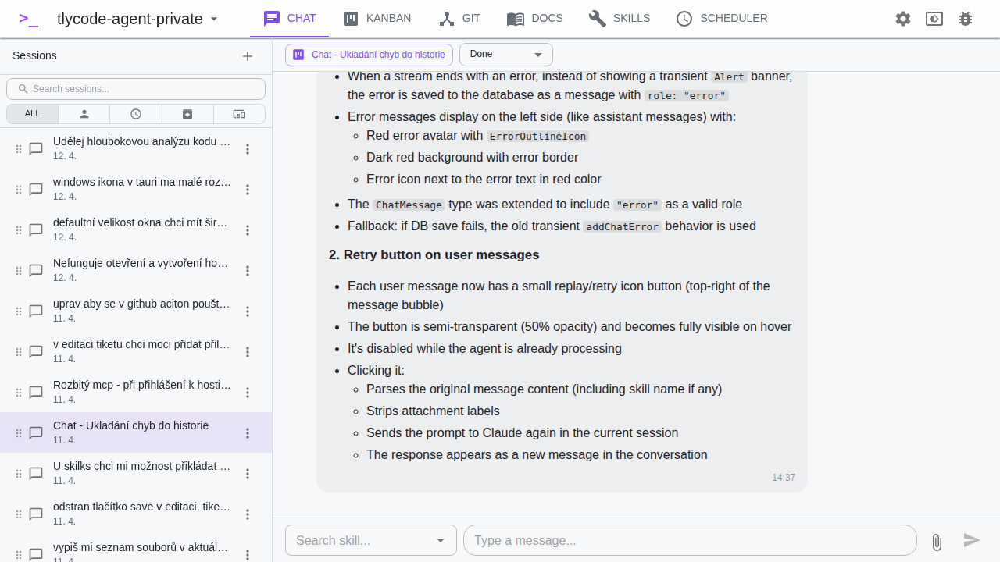

# Chat

The Chat view is the primary interface for interacting with Claude AI.



## Sessions

The left sidebar shows your chat sessions:

- Click **+ New Chat** to create a new session
- Click a session to open it
- Use the **search bar** to find sessions (see [Search](#search))
- Filter by type: **All**, **User**, **Scheduler**, **Archive**
- Active sessions (with ongoing AI responses) show a spinner indicator — even across projects
- Right-click or use the menu to rename, archive, or delete a session

## Search

### Across sessions

The sidebar's search box looks through the project's sessions. The **tune icon**
next to it sets where it looks:

- **Session title**
- **Message content**

Both are on by default, they combine (a session is found if either matches), and
the last one left on cannot be turned off — "search nowhere" would just make the
box look broken. The choice is remembered for next time.

A session found by its messages shows how many of them contain the query next to
its date, and the matching part of a title is highlighted. **Clicking a result
opens the session with the same search already running**, so you land on the
words you were looking for.

Which sessions are searched follows the tab you are on: the **Archive** tab
searches the archive, the others search the open sessions. The **Other projects**
and **Shared** tabs match on the title only — their rows come from elsewhere.

### Inside a session

Press **Ctrl+F** (**⌘F**) to search the open conversation — it works even while
you are typing in the prompt, and pressing it again selects the current query.
**Esc** closes the search and puts the cursor back where it was. With no session
open, the same shortcut jumps into the session list's search box. Every occurrence is
highlighted inside the message bubbles, and **↑/↓** (or Enter / Shift+Enter)
steps through the matching messages — the counter reads "message 2 / 7" for that
reason, as one message can contain several occurrences. Stepping to a message
scrolls to its first occurrence, so a long answer doesn't leave you hunting for
the match.

Searching is a plain case-insensitive substring match: no fuzzy matching, and
`a` does not find `á`.

## Sending Messages

1. Type your message in the text input at the bottom
2. Optionally select a **Skill** from the dropdown to provide additional context
3. Click **Send** or press Enter

The skill's content is sent as a system prompt (`--append-system-prompt`) — Claude receives it as additional instructions alongside your message.

## Streaming Responses

Claude's response streams in real-time:

- **Thinking phase** — Claude is processing (spinner shown)
- **Text** — response text appears progressively
- **Actions** — thinking blocks and tool calls are shown as collapsible sections
  - The collapse state is persisted per message — if you collapse an actions block, it stays collapsed across sessions

## Attachments

Click the **paperclip icon** to attach files to your message:

- **Source code** (`.rs`, `.ts`, `.py`, etc.) — content is read and included inline in the prompt
- **Text files** (`.md`, `.txt`, `.json`) — content is included inline
- **Binary files** — file metadata (name, size, type) is described to Claude

Files are automatically copied to the application data directory for persistence. Pending attachments (not yet sent) can be removed before sending.

## Images, Diagrams and Choices in Agent Replies

An assistant message is markdown, and besides text the bubble renders:

- **Images from the project** — `` with a path relative to the project root (the session's worktree when it has one) loads the image straight from the project folder. Only image files (`png`, `jpg`, `gif`, `webp`, `svg`, …) are loaded, and never anything outside the project.
- **Uploaded images** — `` shows an attachment the agent uploaded with the MCP tool `add_assistant_attachment`. For a file already on disk (a Playwright screenshot, a rendered chart) the agent passes `file_path`, so the image does not have to go through its output as base64. The agent puts the reference straight into its reply — every chat agent is told how in its system prompt, together with its session id — and the reply takes the attachment over, so it never turns up among your own pending attachments. An attachment shown inline gets no second thumbnail under the message.
- **Mermaid diagrams and charts** — a ```` ```mermaid ```` block is drawn as a diagram: flowcharts, sequence diagrams, but also charts (`pie`, `xychart-beta`).
- **Choices** — a ```` ```tlycode-ui ```` block with a small JSON description renders buttons or a pick list. A click sends the text defined in the block as your next message, so it works with every agent. Once anything is sent after the message, the block turns read-only and marks what was picked.

  ```json
  {"type": "buttons", "title": "Deploy now?", "buttons": [{"label": "Yes", "send": "Yes, deploy"}, {"label": "No"}]}
  {"type": "choice", "title": "Which environment?", "options": ["staging", "production"], "send": "Deploy to {value}"}
  ```

  A block with an unknown `type`, invalid JSON or out-of-range fields stays visible as plain code.

Diagrams and choices appear once the reply has finished streaming; while it is still being written they show as code. Raw HTML, SVG markup and scripts in a reply are never rendered.

## Permissions

When running in **Default** or **Plan** permission mode, Claude may ask for permission before modifying files or running commands. A permission prompt appears in the chat — click **Allow** or **Deny**.

In **Automatic** mode, Claude runs without asking (the `--dangerously-skip-permissions` flag is used).

## Error Messages

If Claude encounters an error, the error is saved as a message in the conversation history with a distinct style. Each error message has a **Retry** button that lets you resend the original prompt.

## Cross-Navigation with Kanban

- From a chat session, click **Create Ticket** to create a Kanban ticket linked to the conversation
- If a chat session is linked to a ticket, a link to that ticket appears at the top of the chat
- Clicking the link navigates directly to the Kanban view and opens the ticket dialog

## Diff Review

When Claude makes code changes, a **Diff Review Panel** can display the changes with syntax highlighting. You can add inline comments on specific lines of added, deleted, or context code.

## Session Continuity

Each chat session maintains a Claude CLI session ID. When you reopen a session and send a new message, the conversation continues from where it left off (using `--resume`).
