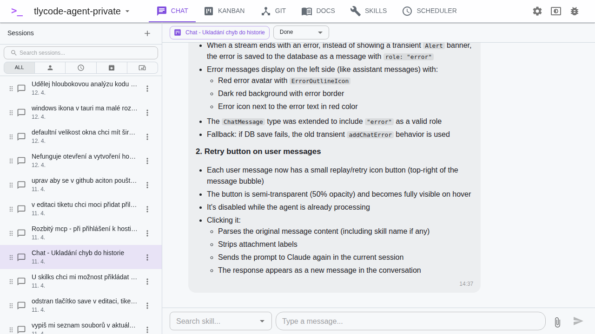

# Chat

The Chat view is the primary interface for interacting with Claude AI.



## Sessions

The left sidebar shows your chat sessions:

- Click **+ New Chat** to create a new session
- Click a session to open it
- Use the **search bar** to find sessions (see [Search](#search))
- Filter by type: **All**, **Favorites** (★), **User**, **Scheduler**, **Archive**
- Active sessions (with ongoing AI responses) show a spinner indicator — even across projects
- Right-click or use the menu to star, rename, archive, or delete a session
- Drag a session by its handle to reorder the list

### Favorites

Click the **star** on a session's row to keep it at the top of the list. An unstarred session shows a muted outline that brightens on hover; a starred one shows a filled star. Clicking it does not open the session. The row's menu has **Add to favorites** / **Remove from favorites** too. The star in the chat header does the same for the open session, and a second click removes it.

- Starred sessions are always listed above the others, under a **Favorites** title, whatever sessions are created or updated meanwhile. A new star goes to the top of them.
- The **Favorites** filter shows only the starred sessions. Search keeps them first too.
- Drag sessions to reorder them within their group; dropping a starred session among the others (or the other way round) changes nothing.
- Stars are your own: in [server mode](server-mode.md) every user keeps their own favorites, also on sessions shared through a group, and nobody else's list changes.
- An archived session keeps its star (it is shown first in the **Archive** filter) and is back among the favorites once restored. Deleting a session removes its star.

## Search

### Across sessions

The sidebar's search box looks through the project's sessions. The **tune icon**
next to it sets where it looks:

- **Session title**
- **Message content**

Both are on by default, they combine (a session is found if either matches), and
the last one left on cannot be turned off — "search nowhere" would just make the
box look broken. The choice is remembered for next time.

A session found by its messages shows how many of them contain the query next to
its date, and the matching part of a title is highlighted. **Clicking a result
opens the session with the same search already running**, so you land on the
words you were looking for.

Which sessions are searched follows the tab you are on: the **Archive** tab
searches the archive, the others search the open sessions. The **Other projects**
and **Shared** tabs match on the title only — their rows come from elsewhere.

### Inside a session

Press **Ctrl+F** (**⌘F**) to search the open conversation — it works even while
you are typing in the prompt, and pressing it again selects the current query.
**Esc** closes the search and puts the cursor back where it was. With no session
open, the same shortcut jumps into the session list's search box. Every occurrence is
highlighted inside the message bubbles, and **↑/↓** (or Enter / Shift+Enter)
steps through the matching messages — the counter reads "message 2 / 7" for that
reason, as one message can contain several occurrences. Stepping to a message
scrolls to its first occurrence, so a long answer doesn't leave you hunting for
the match.

Searching is a plain case-insensitive substring match: no fuzzy matching, and
`a` does not find `á`.

## Sending Messages

1. Type your message in the text input at the bottom
2. Optionally select a **Skill** from the dropdown to provide additional context
3. Click **Send** or press Enter

The skill's content is sent as a system prompt (`--append-system-prompt`) — Claude receives it as additional instructions alongside your message.

## Streaming Responses

Claude's response streams in real-time:

- **Thinking phase** — Claude is processing (spinner shown)
- **Text** — response text appears progressively
- **Actions** — thinking blocks and tool calls are shown as collapsible sections
  - The collapse state is persisted per message — if you collapse an actions block, it stays collapsed across sessions

## Capability Runs

A ticket's prompt queue or a capability run from the **Capabilities** button
goes one step per turn. Its steps fold into **one group** in the chat — a header
with the run's name, how far it is (*step 2 / 4*, *item 3 of 10* inside a loop)
and how many messages it holds; click it to unfold. The run's closing answer and
the answers of steps marked *Show answer* stay outside the group. The bar above
the message box stops and continues the run. See
[Capabilities → Runs in the chat](./capabilities.md#runs-in-the-chat).

## Attachments

Click the **paperclip icon** to attach files to your message:

- **Source code** (`.rs`, `.ts`, `.py`, etc.) — content is read and included inline in the prompt
- **Text files** (`.md`, `.txt`, `.json`) — content is included inline
- **Binary files** — file metadata (name, size, type) is described to Claude

Files are automatically copied to the application data directory for persistence. Pending attachments (not yet sent) can be removed before sending.

## Images, Diagrams and Choices in Agent Replies

An assistant message is markdown, and besides text the bubble renders:

- **Images from the project** — `` with a path relative to the project root (the session's worktree when it has one) loads the image straight from the project folder. Only image files (`png`, `jpg`, `gif`, `webp`, `svg`, …) are loaded, and never anything outside the project.
- **Uploaded images** — `` shows an attachment the agent uploaded with the MCP tool `add_assistant_attachment`. For a file already on disk (a Playwright screenshot, a rendered chart) the agent passes `file_path`, so the image does not have to go through its output as base64. The agent puts the reference straight into its reply — every chat agent is told how in its system prompt, together with its session id — and the reply takes the attachment over, so it never turns up among your own pending attachments. An attachment shown inline gets no second thumbnail under the message.
- **Mermaid diagrams and charts** — a ```` ```mermaid ```` block is drawn as a diagram: flowcharts, sequence diagrams, but also charts (`pie`, `xychart-beta`).
- **Choices** — a ```` ```tlycode-ui ```` block with a small JSON description renders buttons or a pick list. A click sends the text defined in the block as your next message, so it works with every agent. Once anything is sent after the message, the block turns read-only and marks what was picked.

  ```json
  {"type": "buttons", "title": "Deploy now?", "buttons": [{"label": "Yes", "send": "Yes, deploy"}, {"label": "No"}]}
  {"type": "choice", "title": "Which environment?", "options": ["staging", "production"], "send": "Deploy to {value}"}
  ```

  A block with an unknown `type`, invalid JSON or out-of-range fields stays visible as plain code.

Diagrams and choices appear once the reply has finished streaming; while it is still being written they show as code. Raw HTML, SVG markup and scripts in a reply are never rendered.

## Permissions

When running in **Default** or **Plan** permission mode, Claude may ask for permission before modifying files or running commands. A permission prompt appears in the chat — click **Allow** or **Deny**.

In **Automatic** mode, Claude runs without asking (the `--dangerously-skip-permissions` flag is used).

## Error Messages

If Claude encounters an error, the error is saved as a message in the conversation history with a distinct style. Each error message has a **Retry** button that lets you resend the original prompt.

## Cross-Navigation with Kanban

- From a chat session, click **Create Ticket** to create a Kanban ticket linked to the conversation
- If a chat session is linked to a ticket, a link to that ticket appears at the top of the chat
- Clicking the link navigates directly to the Kanban view and opens the ticket dialog

## Diff Review

When Claude makes code changes, a **Diff Review Panel** can display the changes with syntax highlighting. You can add inline comments on specific lines of added, deleted, or context code.

## Session Continuity

Each chat session maintains a Claude CLI session ID. When you reopen a session and send a new message, the conversation continues from where it left off (using `--resume`).

## Agent Settings

The robot button in the chat header opens **Agent settings** for the open session. They apply to this session only and win over the project's settings. The dialog has three tabs: **Agent** (CLI and model), **Model parameters** (reasoning, context length and edit strategy) and **MCP and tools**. The last two are for LM Studio only; with a CLI agent they are greyed out and the Agent tab says why.

- **Agent CLI** and **model**: empty = the project default. Changing the CLI starts a new conversation with the agent (the chat messages stay).
- **Context length** (LM Studio only): how many tokens the model's context window holds in this session. It overrides *Settings → Agent → LM Studio → Context length* (and in server mode your own or your group's value). Leave it empty, or press **Default**, to use the setting again. The presets 4k / 8k / 16k / 32k and *model max* fill it in. Below the field you can see the model's maximum and the context it is loaded with now. A value above the model's maximum can't be saved. If the model's maximum changes later, the turn uses the maximum and says so at the top of the answer.
  - A new context length starts a new LM Studio conversation with the next message (the history is sent again, shaped by the context management), and LM Studio loads the model with the new length. Two sessions using the same model with different context lengths make LM Studio reload the model, or load a second copy, when you switch between them.
  - The `ctx` chip under an answer shows the session's window.
  - For CLI agents the context length comes from the model and can't be set here.
- **Reasoning** (LM Studio only): overrides *Settings → Agent → LM Studio → Reasoning* for this session. *From the project settings* goes back to the setting, *Model default* sends nothing. Only the values the selected model offers are listed; for a model without a reasoning setting the field is disabled. The change takes effect with the next message and doesn't start a new conversation. See [Reasoning](./settings.md#lm-studio).
- **Edit strategy** (LM Studio only, on the *Model parameters* tab): overrides *Settings → Agent → LM Studio → Edit strategy* for this session — *Automatic*, *Text replacement*, *Line anchors*, *By symbol*, *SEARCH/REPLACE blocks* or *Whole file*. *From the project settings* goes back to the setting. The change takes effect with the next message, which starts a new LM Studio conversation. A ticket's agent can set it too and passes it to the ticket's session. See [Edit strategy](./settings.md#lm-studio).
- **MCP and tools** (LM Studio only): which MCP servers and tools the local agent gets in this session. *From the project* uses [MCP for the local agent](./settings.md#mcp-for-the-local-agent-lm-studio) as set in Settings → Integrations. *Own for this session* starts from a copy of the project's selection and shows the same editor: the built-in servers with their tool checklists, other servers, and the size of the selected tools. The size is rated against the context length chosen on the Model parameters tab, or the setting's when none is chosen. **Copy from the project** starts over from the project's selection. The session's own selection replaces the project's as a whole; it is not merged with it. Default servers such as context7 are added to it the same way as to the project's. Changes are stored with **Save**, and the next message starts a new LM Studio conversation with the new set of tools. A server's **Secret** header goes into an environment variable of the project right when you add the server, as it does in Settings.

Agents can set the same values with the MCP tool `set_chat_session_agent` (`local_mcp` for the MCP selection, `null` = back to the project's).

A ticket's session can get its agent from the ticket (see [The ticket's agent](./kanban.md#the-tickets-agent)). The dialog then says *Taken from ticket #N*, or which agent the ticket has when the session's differs. The last change wins: what you save here stays until the agent is changed on the ticket again.

## Session Tools Menu

The **☆** button next to it stars or unstars the open session (see [Favorites](#favorites)). The **⋯** button in the chat header (next to *Agent settings*) opens the session tools:

- **Session info**: the tlycode **Session ID** and the agent CLI's own session ID (**Claude / Codex / Gemini / OpenCode / Copilot session ID**, the one passed to `--resume`). Each has a copy button. The CLI session ID appears with the agent's first answer; before that the menu says it has not been created yet. LM Studio sessions have no CLI session ID.
- **Claude Remote session** (desktop app, Claude CLI sessions only): shares the conversation through Claude Code [Remote Control](https://code.claude.com/docs/en/remote-control) and opens it at claude.ai/code, so you can continue from a browser or the Claude mobile app. Claude still runs on your machine, in the session's folder (its worktree, or the project).

### Claude Remote session

- **Requirements**: Claude CLI signed in with a claude.ai account (Pro, Max, Team or Enterprise; on Team/Enterprise an admin has to enable Remote Control). API keys, `ANTHROPIC_BASE_URL` gateways, Bedrock/Vertex and long-lived `setup-token` tokens do not work. The session needs a Claude session ID, so send the first message before sharing.
- **While shared**: the **⋯** button shows a green dot and a banner above the input offers **Open** and **Stop sharing**. tlycode does not send prompts to the session meanwhile — the send button is disabled, and prompts from MCP, flows or the scheduler wait in the queue until sharing stops — so the web and tlycode never write the same conversation at once.
- **Messages from the web** show up in the chat as they come (checked every 2 seconds): your prompt right away, Claude's answer once its turn ends. Only text is copied, not tool calls. A line *Added from Claude Remote Control: N message(s)* above them keeps the count.
- **Stop sharing**: from the banner or the menu. The last messages are added; if the web conversation cannot be read, a warning line says the history may be incomplete. The next prompt still continues the whole conversation, because Claude has it. Queued prompts run afterwards.
- Sharing also stops when you delete or archive the session, switch it to another CLI or worktree, or quit the app.
- If Claude CLI reports invalid rules in a settings file (e.g. `mcp__*` in `permissions.allow`), sharing continues without them, as chat turns do. Any other dialog the CLI stops at fails the start with its text shown.
- If the start fails, an error explains why (not signed in, API key in use, organization policy, outdated CLI, network…); *Claude CLI output* shows what the CLI printed.
- In server mode the item is disabled.
