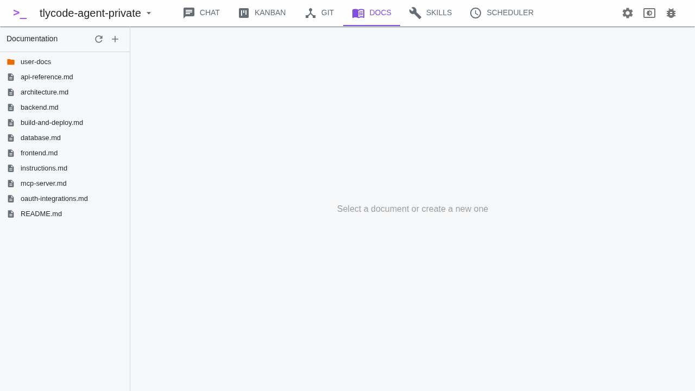

# Documentation

The Docs view lets you browse and edit markdown documentation in your project's `docs/` folder.

## File Tree

The left panel shows a tree of all documentation files:

- `.md`, `.mdx`, and `.txt` files are shown
- Image files (`.png`, `.jpg`, etc.) are shown but not editable
- Folders are listed first, then files (alphabetically sorted)
- Hidden files (starting with `.`) are excluded

## Editing

Click a file to open it in the editor:

- Edit the content directly in the text area
- Changes are auto-saved
- Markdown is rendered with support for **Mermaid diagrams** — fenced code blocks with `mermaid` language are rendered as diagrams

## Outline

Long documents get a chapter list. In **Preview** mode the toolbar has an outline button
(the bulleted-list icon) that opens a panel on the right:

- Every heading of the document, indented by its level
- Clicking a chapter scrolls the preview to it
- The chapter you are reading is highlighted and follows you as you scroll
- The panel appears once a document has at least two headings, and whether it is open is
  remembered for the next document you open
- On a phone the outline opens as a drawer and closes again once you pick a chapter

Only `#`-style headings count, and headings inside fenced code blocks are ignored — a
`# install dependencies` line in a shell example is not a chapter. The outline is part of
the preview, so it is not available while editing.

## Managing Files

- Click the **+** button to create a new file or folder
- Right-click a file to rename or delete it
- Click **Refresh** to reload the file tree
- Folders can be created and deleted recursively
