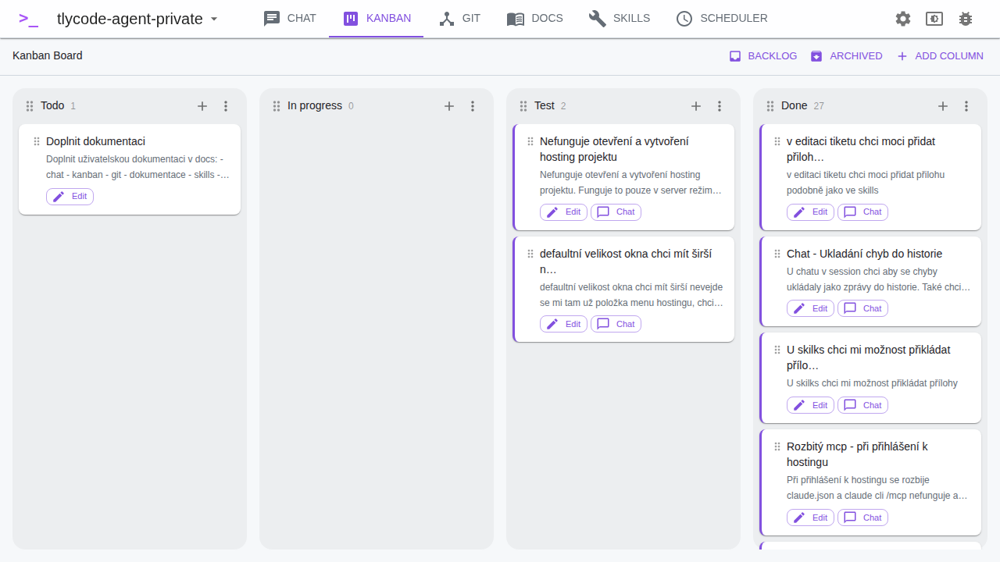
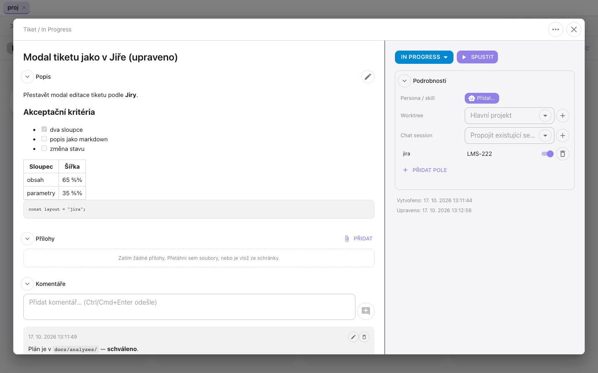

# Kanban Board

The Kanban board helps you track tasks and organize your work.

## Columns

By default, three columns are created: **To Do**, **In Progress**, **Done**.

- Click **Add Column** to create a new column
- Click a column title to rename it
- Drag columns to reorder them
- Delete a column via its menu (all tickets in it will be removed)

## Tickets

- Click **Add ticket** (+ button) on a column to create a new ticket
- Click **Edit** on a ticket to open the ticket dialog
- **Drag and drop** tickets between columns to change their status

### Ordering cards in a column

The order of the cards inside a column is their priority, and it is kept — drag
a card up or down and it stays where you dropped it.

Dragging stops being practical in a long column, where the other end is off
screen. The **Move** button on the card does the same thing in two clicks:

- **To top of column** / **To bottom of column** — reorder inside the card's
  own column
- **To column** — hand the card over to another column, at its top

While a search is on, only *to top* is offered: the end of a filtered column is
not the end of the real one.

An agent can order a whole column in one go — see the built-in **Backlog
ordering** skill, which takes the priorities from a backlog (the Jira ranking,
for instance) and writes that order onto the board.

### Ticket Dialog

The ticket dialog lets you edit all ticket properties:

- **Title** — the ticket name
- **Description** — detailed description of the task (markdown supported)
- **System Prompt** — a custom system prompt that will be sent to Claude when running this ticket
- **Skill** — attach a skill to use as context when running the ticket
- **Custom fields** — the project's own fields (Settings ▸ Kanban), e.g. a Jira ticket number; a field marked *Show on card* also appears as a chip on the card in the board. Fields computed from the linked session (see *Session chips* below) are not listed here — there is nothing to type in.
- **Attachments** — upload file attachments to the ticket (stored as base64)
- **Chat Session** — link to an existing chat session or create a new one
- **Comments** — add comments to the ticket for discussion or notes

### Session chips

A card can also carry two chips computed from its linked chat session, so the numbers that decide whether to work in that session are visible at a glance instead of being typed into the description:

- **tokens in context** — the input side of the session's last turn. Highlighted once it passes the project's threshold, which is where rotating the session into a fresh one starts to pay off.
- **session hotness** — `until 14:32 (12 min)` while the prompt cache is still hot, `cold` afterwards. Waking a cold session re-reads the whole context, so a cold chip is a warning that the next turn is expensive.

Both are off until you add them in Settings ▸ Kanban as a ticket field whose *Value source* is the session (same place, and the same *Show on card* switch, as the project's own fields). The hot window and the warning threshold are set there too. The chips refresh when a turn finishes; the hotness countdown ticks on its own.

### Running a Ticket

When a ticket has a description, system prompt, or skill, you can run it directly — this creates a new chat session with the ticket's context and sends the description as a prompt to Claude.

## Search

Type into the search box on the board toolbar and the cards filter as you type —
you stay on the board, no switching to a list. Each column then shows only its
matches, and the number next to the column title is the number of matches in it.
Press **Esc** or click the ✕ to go back to the whole board.

The sliders button next to the box picks where to look. The three choices are
independent and a card matches if any of them does:

- **Card title**
- **Card description** — handy if you keep notes like "tested Oct 12" there
- **Session title** — the name of the chat session linked to the card

Title and description are on by default, session title is off; the choice is
remembered. At least one has to stay on.

Searching looks for cards whose text *contains* what you typed, ignoring case,
and the whole board is searched — not just the cards already loaded. Archived
and backlogged tickets have their own search in their own views.

While a search is on, cards cannot be dragged: a position inside a filtered
column is not the card's position in the real column, so a drop would reorder
the column wrongly. Use the **Move** button on the card instead — it puts the
card at the top of the column you choose.

## Backlog

Click the **Backlog** button to manage tickets that aren't on the board yet. Backlog supports search and pagination. Tickets can be moved between backlog and the board.

## Archive

Click **Archived** to view and restore archived tickets. Archive also supports search and pagination. When a ticket is archived, its linked chat session is also archived.

## Flow Manager

Click **Flow manager** on the board toolbar to run a batch of tickets in a
planned order.

A **flow** is a list of named **steps**. Drag tickets from the board panel into
a step, reorder them inside it, or drag them to another step. Steps run in
order: the next one starts only once every ticket of the current one has
finished.

Each step decides how its tickets run:

- **Sequential** — one ticket at a time, in the order you arranged them.
  **Parallel** — all of them at once (optionally capped by *Max at once*).
- **Own session** — every ticket runs in its own chat session.
  **One session** — the whole step runs in a single shared chat session, so the
  agent keeps the context of the previous tickets. Only available for a
  sequential step, because one session handles one turn at a time.

Use **Start**, **Stop** and **Reset** to control the run:

- **Start** begins the flow, or resumes it after a Stop at the first unfinished
  ticket.
- **Stop** cancels the turns that are in flight and dispatches nothing more;
  those tickets go back to waiting.
- **Reset** puts every ticket back to waiting. The chat sessions and their
  messages are kept, so the record of what the flow did stays in Chat.

The flow's own menu (the ⋮ on its row) has **Log** — what the run did, newest
first: when it was started, stopped or reset, which ticket went to the agent
and into which chat session, and what failed. A reset is logged too, so the
counters going back to zero is never a mystery. Each flow keeps its last 500
entries.

If the agent runs out of tokens mid-run, the flow does not fail: it parks as
**Waiting for the limit**, the ticket goes back to waiting, and a one-off task
appears in the **Scheduler** that starts the flow again when the limit should
have reset. You can postpone, disable or delete that task, or press Start
yourself — doing so removes the scheduled one. After five waits with no
success the flow gives up and fails.

Moving a ticket to the **backlog** or **archive** takes it out of every flow it
was in — a plan made of tickets that are not on the board is one you cannot
reason about. Bringing the ticket back does not put it into the flow again.
A ticket the agent is working on right now is the exception: it stays until
that run finishes, so archiving never cancels work silently.

Every ticket and every step shows its state — waiting, working, done, failed or
skipped (an archived or deleted ticket is skipped). A failed ticket stops the
flow unless you turn that off for the flow. The flow never moves tickets
between columns, so your board stays as you left it.

## Column Prompts

In **Settings**, you can configure a prompt and skill for each column. When a ticket is moved to a column that has a prompt configured, the prompt is automatically sent to the ticket's linked chat session.

While the agent is responding in a ticket's chat session, that ticket cannot be moved into a column whose prompt would then land in the running session — the board says so and leaves the card where it was. Every other move goes through: reordering inside a column, and moving into a column that has no prompt configured. The switch next to **Column Prompts** in Settings turns the prompts off altogether, and with them this restriction.

## Cross-Navigation with Chat

- Click the **chat link** on a ticket to navigate directly to its linked chat session
- From a chat session, the linked ticket is shown at the top with a link back to the Kanban view
