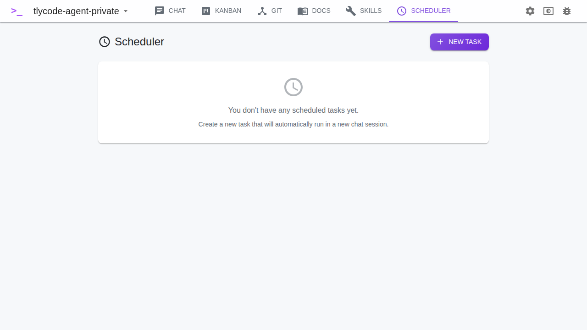

# Scheduler

The Scheduler lets you create tasks that run automatically — either at a fixed interval or at an exact time — sending a prompt to Claude in a new or an existing chat session.

## Creating a Task

1. Click **New Task**
2. Configure:
   - **Persona / Skill** (optional) — the context to run with
   - **Message** — the prompt to send to Claude
   - **Schedule** — see below
   - **Where to run** — a new session, or an existing one
   - **Notify** — send a system notification when the task runs (desktop only)
3. The task is created and, for interval schedules, starts running immediately

## Schedule

Three ways to define when a task runs:

- **Interval** — every 1, 5, 10, 15 or 30 minutes, or every 1, 2, 6, 12 or 24 hours.
- **At a set time** — pick the weekdays and a time (e.g. Mon–Fri at 7:30). Leaving all days unselected means every day.
- **Cron expression** — a standard 5-field expression: `minute hour day-of-month month day-of-week`, where `0` is Sunday. For example `0 9 * * 1-5` is every weekday at 9:00.

### Time window

Independently of the schedule, you can switch on **Restrict to a time window** and pick weekdays plus a from–to time. The task then only runs inside that window.

This is how you combine an interval with an exact time: interval *every 30 minutes* plus a window of *Mon–Fri 8:00–18:00* runs at 8:00, 8:30, … 17:30, and then resumes at 8:00 on the next working day.

A window that ends before it starts (e.g. 22:00–06:00) wraps past midnight. The weekday is evaluated at the moment the window opens, so a Monday window of 22:00–06:00 covers Monday 22:00 through Tuesday 06:00.

### Preview

As you edit the schedule, the dialog shows the **next 5 runs** along with the server's current time and UTC offset. Schedules are always evaluated in the server's timezone, not your browser's — in server mode these can differ.

If the schedule can never fire (for example cron `0 3 * * *` with an 08:00–18:00 window), the preview says so and the task cannot be saved.

## Where to Run

- **New session** — each run creates a fresh chat session titled `[Scheduler] <skill or persona>`.
- **Existing session** — each run appends the prompt to a session you pick, keeping the conversation history. The run inherits that session's worktree.

For an existing session, **Skip the run while the session is responding** is on by default. Without it, a frequent schedule would keep stacking prompts onto a session that is still working.

If the target session is deleted, the task falls back to creating a new session and shows a warning on the task row.

## How It Works

The scheduler runs a background loop every 10 seconds and compares each enabled task against its precomputed next run time. When a task is due, it:

1. Resolves the target session (creating one if needed)
2. Sends the message to Claude with the skill or persona as context
3. Records the run and computes the next one
4. Optionally sends a system notification

Runs missed while the app was closed are **skipped**, not caught up — the task simply resumes at its next scheduled slot.

## Managing Tasks

- **Enable/Disable** — toggle a task on or off with the switch. Re-enabling restarts the schedule from now.
- **Edit** — change the message, schedule, window, target or context
- **Delete** — remove the task permanently
- **Run Now** — trigger a task immediately, regardless of the schedule and of whether the session is busy

Each task row shows its schedule, the target session (if any), the last run, the next run, and the last error or warning.

## Viewing Results

Scheduler-created sessions appear in the Chat sidebar. Use the **Scheduler** filter in the chat view to see only scheduler-generated sessions.
