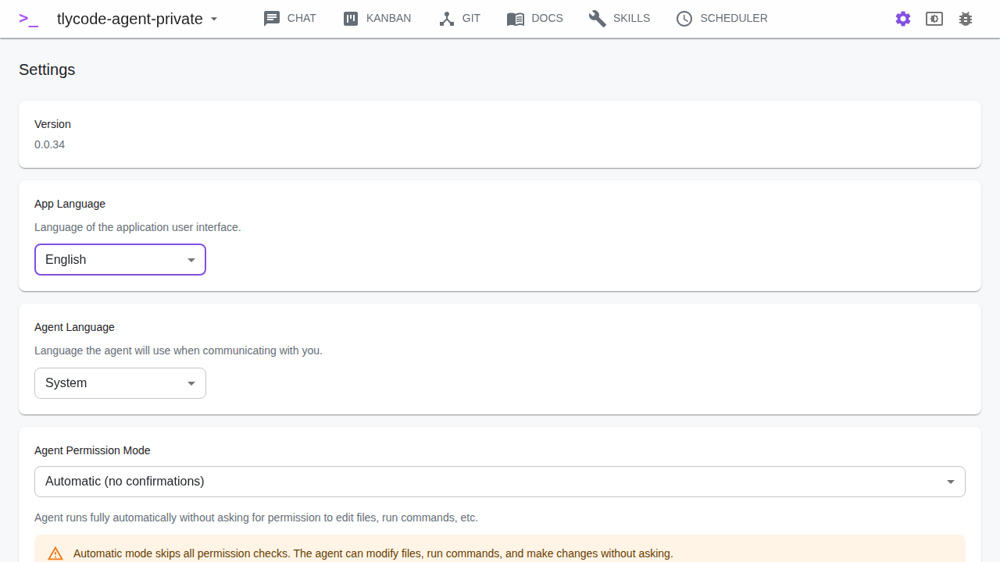

# Settings

## Application Language

Select the language for the UI. Available: Czech (Čeština) and English.

## Agent Language

Select the language Claude will use in responses. This is independent of the UI language.

## Agent Permission Mode

Controls how Claude handles file modifications and command execution:

- **Default** — Claude asks for permission before each action (interactive approval via the chat UI)
- **Plan** — Claude creates a plan first, then asks for approval before executing
- **Automatic (Fully automatic)** — Claude runs without any permission checks. A warning is shown — use with caution as Claude will modify files and run commands without confirmation.

## CLI Agent

Select which CLI agent to use for AI operations. Default is **Claude CLI** (`claude`). Other supported agents (if installed) include Gemini CLI, Codex CLI, and Copilot CLI.

## Launch at Startup

Enable to start TlyCode Agent automatically when the system boots. Desktop only.

## System Check

Click **Run System Check** to re-check the installation status of Claude CLI, Node.js, GitHub CLI, and other supported tools.

## Append Prompt

A text that is prepended to the beginning of every chat prompt. Useful for project-wide instructions. You can also select a **Skill** to use as additional context for all messages.

## First Message Prompt

A text that is added to the beginning of the first message in every new chat session. Useful for onboarding instructions. Also supports an optional skill.

## Column Prompts

Configure a prompt and skill for each Kanban column. When a ticket is moved to a column with a configured prompt, the prompt is automatically sent to the ticket's linked chat session. This enables automated workflows — e.g., when a ticket moves to "In Progress", Claude automatically starts working on it.

The switch in the section header turns the whole thing off. With it off, moving a ticket into a column sends nothing — the per-column settings are kept, so you can switch it back on later. Turning it off also means a card can be moved between columns while its agent is responding: that move is otherwise refused, because the column's prompt would land in a session mid-answer. The switch is per project and lives in `.tlycode-settings.json` (`column_prompts_enabled`); prompt profiles do not change it.

## Kanban ▸ Custom Ticket Fields

Extra fields every ticket in the project has, in the spirit of Jira's custom fields — a Jira ticket number, an estimate, whatever the project needs. Each field has a name and a switch:

- **Name** — the label shown on the ticket and on the card. It can be renamed any time; the key underneath it (shown in grey next to the name) is fixed, because that is what the tickets' values are stored under.
- **Value source** — where the value comes from: *I fill it in on the ticket* (the default), or one of the two numbers computed from the ticket's linked chat session, described below.
- **Show on card** — with it on, the field's value appears as a small chip on the card in the board, so things like a ticket number no longer have to be squeezed into the card's title.

Values of a manual field are filled in per ticket, in the ticket dialog. A field with no value shows no chip. Until you add a field, the board looks exactly as it did before — a project that wants plain cards keeps them plain.

A field defined here is on **every** ticket of the project. For something only one ticket needs, skip this screen: the ticket dialog has its own **Add field**, and a field added there lives on that ticket alone, with its own switch for the card.

### Chips computed from the session

Two value sources are not typed in at all — they are read off the linked session's latest turn:

- **Tokens in session context** — how much the session has in its context, i.e. the input side of its last turn (new input + cache read + cache write). This is *not* the cumulative "Σ tokens" the chat shows: that one counts the whole history and is much larger. The last turn's output is not counted either — it only enters the context when the next request sends it back.
- **Session hotness** — until when the session's prompt cache stays hot, as `until 14:32 (12 min)`, and `cold` once the window is over. Waking a cold session re-reads the whole context, so this is what tells you whether to pick the session up now or let it go.

A computed field has no value to type in, so the ticket dialog does not offer it. A ticket with no linked session — or one whose agent reports no token usage — shows no computed chip.

### Session chips

Two thresholds in the same tab drive those chips:

- **Hot cache (minutes)** — how long after the last turn the session counts as hot. No agent reports this (Claude has both a 5-minute and a 1-hour prompt cache), so the chip is only as honest as this number. Default 60.
- **Warn above (tokens)** — the context size at which rotating the session pays off. Above it the token chip is highlighted; nothing is rotated automatically. Default 160000.

Deleting a field does **not** erase the values stored on the tickets: add the field back and they reappear. The definitions live in `.tlycode-settings.json` (`ticket_fields`) in desktop mode, so they travel with the repository; in server mode they are stored per project in the database. Agents read them over MCP with `get_project_settings` and write values with `update_kanban_ticket`.

## Log Level

Set the verbosity of debug logs:

- **Error** — only errors
- **Warning** — errors and warnings
- **Info** — general information
- **Debug** — detailed debug output
- **Trace** — everything, including throttling and scroll events

## Environment Variables

Define environment variables that will be set when Claude runs commands:

- Click **Add** to create a new variable
- Variables are synchronized with the `.env` file in the project directory
- Useful for API keys, custom paths, configuration values
- Changes are saved immediately

## MCP Servers

Configure Model Context Protocol servers that extend Claude's capabilities:

- **Local (stdio)** — a command that runs locally (e.g. `npx -y @modelcontextprotocol/server-name`)
- **HTTP** — a remote MCP server URL with optional headers
- **HTTP with OAuth** — remote servers that require OAuth authentication

Servers are stored in `~/.claude.json`:
- Global servers (like "tlycode") are in the root scope
- Project-specific servers are under `projects.<project_path>`

To add a server:

1. Choose transport type (Local or HTTP)
2. Enter the command/URL and arguments
3. Optionally add environment variables or headers
4. Click **Add Server**

Servers can be edited or deleted from the list.

### Built-in tlycode-agent Server

TlyCode Agent automatically registers its own MCP server named **tlycode-agent** when a project is loaded. This server provides 60+ tools for controlling chat, kanban, scheduler, skills, git, docs, pipelines and settings — allowing external agents like Claude Code to interact with the application.

See [MCP Server](./mcp-server.md) for full documentation.
