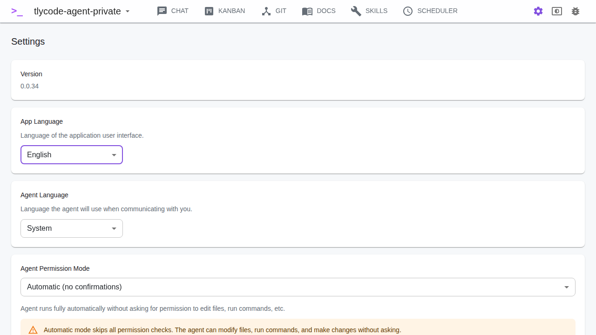

# Settings

## Application Language

Select the language for the UI. Available: Czech (Čeština) and English.

## UI Scale

Text and controls can be made larger or smaller — 80 % to 200 % in 10 % steps, 100 % by default. There are two levels:

- **App scale (Settings → Application):** the slider, the −/+ buttons or **Default (100 %)** set the scale of every app window. It applies immediately and is kept after a restart.
- **Window scale (top bar):** the magnifier icon next to the keyboard shortcuts changes only the current window (−/+ in a small popup). **Use app scale (X %)** returns the window to the app scale. A window with its own scale ignores later changes of the app scale. The main window keeps its own scale after a restart; other windows keep it while they're open.
- **Shortcuts:** Cmd/Ctrl + `=` (or `+`) and Cmd/Ctrl + `-` change the current window's scale, Cmd/Ctrl + `0` returns it to the app scale. The numpad `+`, `−` and `0` keys work too. Shortcuts follow the physical key position like all app shortcuts, so on a Czech layout zoom in is the `´` key and zoom out the `=` key (or use the numpad).
- **Webview windows:** their toolbar follows the app scale; the web page inside is left at 100 %.
- **Server mode (browser):** the app doesn't scale itself there — use the browser's own zoom (Cmd/Ctrl + `+`/`-`/`0`), which the browser remembers for the address.

## Agent Language

Select the language Claude will use in responses. This is independent of the UI language.

## Agent Permission Mode

Controls how Claude handles file modifications and command execution:

- **Default** — Claude asks for permission before each action (interactive approval via the chat UI)
- **Plan** — Claude creates a plan first, then asks for approval before executing
- **Automatic (Fully automatic)** — Claude runs without any permission checks. A warning is shown — use with caution as Claude will modify files and run commands without confirmation.

## CLI Agent

Select which CLI agent to use for AI operations. Default is **Claude CLI** (`claude`). Other supported agents (if installed) include Gemini CLI, Codex CLI, OpenCode CLI, and Copilot CLI. **LM Studio** runs a local model without any CLI — see [LM Studio](#lm-studio) below.

### OpenCode CLI

[OpenCode](https://opencode.ai) is a provider-agnostic CLI agent. Notes specific to it:

- **Sign-in** — OpenCode manages provider credentials itself. Run `opencode auth login` in a terminal; TlyCode Agent does not ask for API keys.
- **Model** — entered as `provider/model` (e.g. `anthropic/claude-sonnet-4-5`). The field suggests models reported by `opencode models` but accepts any value. Leave it empty to use the default model from your OpenCode configuration.
- **Permission mode** — **Plan** runs the OpenCode `plan` agent (read-only); every other mode runs with `--auto`. Rules denied in your OpenCode config stay denied.
- **MCP servers** — servers configured in TlyCode Agent are also synced to `~/.config/opencode/opencode.json` (section `mcp`); other keys in that file are preserved.
- **Streaming** — response text arrives in chunks per agent step, not token by token.

### LM Studio

The **LM Studio** agent chats with a model served by [LM Studio](https://lmstudio.ai) through its native chat API (`POST /api/v1/chat`). LM Studio runs the tool loop itself; TlyCode Agent hands it the tools over MCP and streams the answer token by token.

- **Requirements**
  - LM Studio **0.4 or newer** with its server running.
  - **Allow per-request MCPs** switched on in LM Studio's server settings — without it the model gets no tools.
  - **LM Studio 0.4.26 and newer** no longer call per-request tool servers on a local address (`127.0.0.1`, where TlyCode Agent serves its tools). TlyCode Agent then writes its servers for each message into LM Studio's `~/.lmstudio/mcp.json` (entries named `tlycode-turn-…`, each with a token valid for that message only, removed when the answer ends) and remembers it for that LM Studio until restart. For that, turn on **Require Authentication** and **Allow calling servers from mcp.json** in LM Studio's *Server Settings* and enter a token from *Manage Tokens* in the **LM Studio API token** field (see below). Your own entries in `mcp.json` stay untouched.
  - A model that supports tool calling. The model picker only lists such models.
  - The **System Check** reports a missing server, an old version, the per-request MCP switch, an LM Studio that needs the `mcp.json` route and an enabled API authentication.
- **Model, host and port** — the model comes from LM Studio and is loaded on the first request if it is not loaded yet. LM Studio runs on `127.0.0.1:1234` unless you set *Model host* and *Port* — see [Per-project host and port](./server-mode.md#per-project-host-and-port).
- **API token** — when LM Studio requires an API token (*Require Authentication* in LM Studio's *Server Settings*, tokens under *Manage Tokens*), enter it in the **LM Studio API token** field under *Model host* and *Port*. It is stored in the project's `LM_API_TOKEN` environment variable, not in `.tlycode-settings.json`; you can also set that variable yourself (in the project or in the process running TlyCode Agent). In server mode an admin can also store it as a group secret, which wins over the variable.
- **Tools** — by default the model can read, write and search files, run shell commands and keep a todo list. It also gets a selection of the built-in tlycode-agent MCP tools (kanban tickets and comments, docs, skills, everyday git). Which servers and tools it gets — including other MCP servers such as Playwright — is set in **Settings → Integrations → MCP for the local agent (LM Studio)**, see [MCP for the local agent](#mcp-for-the-local-agent-lm-studio). The tools are served by TlyCode Agent's own MCP server (or by the server you add) and **LM Studio calls them itself**, so:
  - tools only work when LM Studio runs **on the same machine** as TlyCode Agent (the desktop app or the server process),
  - with a remote host the agent is a plain chat without tools, and its first answer says so.
  - There is no "ask the user" tool — the model asks in its answer and you reply in the next message.
- **Permission mode** — **Plan** offers read-only tools only. Every other mode gives the model full file and shell access **without per-call approvals**, so use it in trusted projects only.
- **Limits**
  - A single tool call may currently take about **60 seconds** — LM Studio's fixed timeout. TlyCode Agent stops a tool after 50 s and returns its partial output. Run long commands (builds, test suites) in the background with their output redirected to a file (`cmd > /tmp/out.log 2>&1 &`) and let the model read the file later.
  - **Context management cannot help within a single turn.** LM Studio runs the tool loop, so when one message fills the context with tool output, nothing can be taken out of it. The defence is small tool output: TlyCode Agent cuts the output of its own tools to fit the window; servers from `~/.lmstudio/mcp.json` are out of its reach. When it happens, LM Studio ends the turn without an error of its own and the chat shows that the response ended without a result or came back empty; the next message then starts a new chain.
  - A turn stops after **50 tool calls** (setting `agent_local_max_iterations`, `0` = no limit). LM Studio has no limit of its own and a model can loop on tools until its context overflows.
- **Conversation** — after the first message only the new message is sent; LM Studio continues the conversation it stored (`previous_response_id`). The history is sent again as a new chain when that is not possible: after a change of model, host, context length, persona, skill or language, after you delete or edit a message, after a failed or empty turn, when LM Studio no longer knows the conversation, or when the chain has filled the context window past the threshold.
- **Context length per session** — a chat session can set its own context length in its *Agent settings*. It overrides this setting for that session only, see [Agent Settings](./chat.md#agent-settings).
- **Reasoning** (`agent_local_reasoning`) — whether and how hard the model thinks before it answers: **Model default** (default — nothing is sent, the model does what it does by itself), **Off**, **On**, **Low**, **Medium**, **High**.
  - Each model offers only some of these values; LM Studio reports which (`capabilities.reasoning` in `/api/v1/models`). Below the field you see what the selected model offers. A value the model doesn't offer is adapted: a level becomes *On*, *On* becomes the model's own level; a model without a reasoning setting (e.g. `gemma-4-e2b-it-mlx`) gets nothing sent. The first answer of a conversation says so in a short note. If LM Studio doesn't report the model's abilities and refuses the value, the message is sent again without it and TlyCode Agent remembers that model until it restarts.
  - **Off** doesn't stop every model from thinking: Gemma writes its reasoning into the answer text instead. For Gemma it is better to leave reasoning on.
  - The model's reasoning shows in the answer as a collapsible **Thinking** step, live while it comes; it is never sent back to the model with the history. An answer that ran out of room while the model was still thinking keeps the Thinking step, so you can see where it got stuck.
  - With a value chosen (other than *Off* and *Model default*) each generation is capped at 8k tokens (*Low*), 16k (*On*, *Medium*) or 32k (*High*), never more than half the window — this stops a model looping in its reasoning until the window is full. The cap applies to each step of the tool loop, not to the whole turn.
  - A session can choose its own reasoning in its *Agent settings*; changing it doesn't start a new conversation.
- **Edit strategy** (`agent_local_edit_strategy`) — which tools the model changes files with:
  - **Automatic** (default) — picks by model size (models up to ~9B parameters, e.g. Gemma e2b / e4b, count as small); today it gives every model *Text replacement*.
  - **Text replacement** — `edit_file`: the model copies the exact current lines (`oldString`) and sends the new ones.
  - **Line anchors** — `read_file` shows every line as `12:a3f|…`; `edit_lines` replaces the lines between two such anchors, so the model copies two short anchors instead of the old text. A line that moved or changed is caught instead of editing the wrong one.
  - **By symbol** — `edit_symbol` replaces, inserts after or deletes a whole function, method or class by its name (Rust, TypeScript/JavaScript, PHP, Python); `read_file` lists the file's symbols. Other changes go through `edit_file`.
  - **SEARCH/REPLACE blocks** — the model writes its edits as blocks in the answer instead of tool calls, so code never goes through JSON escaping. TlyCode Agent applies them, sends the result back in the same conversation and the model goes on until it answers without blocks (at most 8 rounds per message). The answer shows the applied blocks as an *apply_edits* step.
  - **Whole file** — the model has only `write_file` and sends the complete new content of the file every time: nothing to copy exactly or to match, at the cost of resending the whole file (slower and more tokens on long files). A rewrite that leaves out a large part of the file or puts a placeholder such as `// ... rest of the code` in place of code is refused, and the model is told to send the whole file again.

  Whatever the strategy, an edit that would break the file's syntax is refused and the file stays as it was — a real parser (tree-sitter) checks Rust, TypeScript/TSX, JavaScript, PHP (including HTML templates), Python, CSS and HTML; JSON, TOML and YAML are parsed; other languages get a bracket check. The model can take back its last edit of a file with `undo_edit`, and an edit of a file that changed since the model read it (a command, you) is refused until it reads it again. A session or a ticket can choose its own strategy in its *Agent settings*; a change starts a new LM Studio conversation with the next message (the tools change).
- **Context management** — LM Studio doesn't compress the context itself; a full chain returns empty answers. So TlyCode Agent watches how full the chain is and, past its limit, starts the next message in a new chain. The limit is **Compaction threshold** (`agent_local_context_threshold`, default 75 %) of the window, or less when the answer would no longer fit: the window minus room for the answer — 2 048 tokens, or the output cap the chosen reasoning level sends — and at least 512 tokens. A 4 096-token window therefore starts a new chain past 2 048 tokens, not 3 072; with 8k and bigger windows and default reasoning the threshold applies as it is. What that chain gets is up to **Context management** (`agent_local_context_policy`):
  - **Compact** (default) — the system prompt, a summary of the older part of the conversation and the newest messages. The summary is a separate request to the same model (not stored in LM Studio, no tools); the next compaction builds on it rather than summarizing everything again. If the summary fails, *Truncate middle* is used instead.
  - **Truncate middle** — the system prompt, your first message (the assignment), a note how many messages were left out and the newest messages.
  - **Rolling window** — the system prompt and the newest messages.
  - **Off** — the chain grows until the window is full; the chat only warns once it passes the threshold.

  The history of a new chain includes the model's tool calls, with each tool output cut to about 1 500 characters (shell output keeps its end). It takes at most half of the room left under the limit after the system prompt, your message and the tool definitions, so the new chain starts well below the limit and isn't shortened again on the next message. Steps of a ticket's prompt queue that are kept out of the session's memory show in the chat but are never replayed. Every step shows in the chat as a grey line between the messages — compacted (with the summary to unfold), shortened, new chain with its reason, or the warning, each with the limit and the size the new chain aimed at — and stays there after a reload. These lines are never sent to a model. A new chain means one full prompt prefill (about 16 s for 16k tokens on gemma-4-e4b); compaction adds the summary request on top.
- **Context fill** — each answer shows how full it left the window (`ctx 16.1k / 16.4k (98%)`), in the warning colour past the threshold; the session footer shows the current chain.
- **Privacy** — LM Studio stores every conversation, including tool output, **for 30 days** on the disk of the machine it runs on, in `~/.lmstudio/.internal/api-prediction-history`.
- **Images** — image attachments are sent to the model directly, so a vision model can see them.

## Launch at Startup

Enable to start TlyCode Agent automatically when the system boots. Desktop only.

## System Check

Click **Run System Check** to re-check the installation status of Claude CLI, Node.js, GitHub CLI, and other supported tools.

## Prompts — moved

The project's prompts (append prompt, first-message prompt, prompt before
deleting a session and the per-column prompts) are no longer a settings tab.
They live on the Kanban board under **Agent profile**, the third view next to
the board and the flow manager — see [Kanban Board](./kanban.md#agent-profile).

The one thing worth repeating here: the **Column prompts** switch is per
project and lives in `.tlycode-settings.json` (`column_prompts_enabled`). Agent
profiles carry prompt *content*, so switching a profile does not change that
switch.

## Kanban

The tab holds the **Jira sync**: issue changes come to TlyCode over a webhook,
or TlyCode polls them from the Jira REST API, and they show up as cards on a
board. Step by step, and which method to pick, is in
[Kanban → Sync from Jira](kanban.md#sync-from-jira). The cloud edition has no
Jira sync; the tab only says so there.

- **Webhook server** (global, for every project). The port (default `45893`)
  and the address the listener binds to: `127.0.0.1` (this computer only) or
  `0.0.0.0` (every interface). **Apply** moves the listener without
  restarting the app. On a server only an administrator can change these.
  - The card shows whether the listener runs, why it could not start (port
    taken, …) and the last delivery since the app started, with the sync it
    went to.
  - A note under it says what can reach the listener with this bind. A
    desktop needs a tunnel for Jira Cloud; Jira Server on your network needs
    `0.0.0.0`. A server with a public URL takes deliveries on its main port
    anyway. Syncs using API polling do not need the listener.
- **Sync from Jira** (per board). Pick the board when the project has more
  than one. The list opens on the board you came from (the sync icon on a
  board), otherwise on the first board with a running sync. The board picker
  shows how many syncs each board has ("Jira · active: 1"); a board without a
  sync lists the boards that have one, with a button to switch. The board's
  syncs are listed as collapsible cards; the header of each shows its name,
  whether it is on, and its last delivery or error (for polling: the last
  fetch and how many issues it processed). The webhook server's "No delivery"
  line only concerns syncs in webhook mode.
  **Add sync** adds another one (two Jira instances, two teams; see
  [Several syncs on one board](kanban.md#several-syncs-on-one-board)). In each
  sync, set:
  - its name,
  - the main switch,
  - the **sync method**: *Webhook* or *API polling*. For polling: the Jira
    Base URL, e-mail (Jira Cloud only), API token, API version, interval in
    minutes and optional JQL. **Take from the Jira MCP preset** fills them in
    from the project's Jira MCP server. **Test connection** shows the account
    and how many issues the query finds, or what is wrong. The polling status
    (last fetch, issues processed, last error, next fetch) and **Sync now**
    are below. The webhook URL and secret are hidden in this mode,
  - which of the six events to apply,
  - the default column for new issues,
  - the Jira status → column mapping,
  - project key, assignee and sprint filters,
  - the HMAC secret (webhook only),
  - whether moves fire column prompts.

  **Save** stores it. The first save creates the sync's webhook URL with its
  token, which you copy from here. **Generate a new token** replaces it after
  a confirmation; the old URL stops working at once. The secret and the API
  token are never shown again after saving: leave the field empty to keep
  them, or use **Remove secret** / **Remove token**. **Delete sync** removes it after a confirmation: its URL
  stops working, the cards it created stay.

  **Log** at the top of a saved sync opens its log: every webhook delivery
  and every poll with what it did to the cards, filterable and with links to
  the card and the Jira issue. Next to it, the last 24 hours in numbers. See
  [The sync log](kanban.md#the-sync-log). **Sync logs** below the list sets how
  many entries (default 1000) and how many days (default 30) each sync keeps
  (on the server, admins only).

### Custom ticket fields, without the editor

Custom ticket fields — a Jira ticket number, an estimate, whatever the project
needs — used to be defined on this tab. The fields themselves are still there
and a board that has them keeps showing them; what is gone is the screen that
edited the project-wide ones. Two ways in are left:

- **Per ticket** — the ticket dialog's own **Add field**. A field added there
  belongs to that ticket alone and has its own switch for the card. That covers
  everything a single ticket needs.
- **For the whole project** — the `ticket_fields` key in
  `.tlycode-settings.json` (in server mode, the project's settings in the
  database), which an agent writes over MCP with `save_project_setting` and
  reads with `get_project_settings`. Each entry has a `key` (fixed, it is what
  the values hang on), a `label`, a `show_on_card` switch and a `source`:
  `manual`, `session_tokens` or `session_hot`.

Deleting a field does **not** erase the values stored on the tickets: add the
field back and they reappear.

### Chips computed from the session

A field whose source is the session is not typed in at all — it is read off the
linked session's latest turn:

- **Tokens in session context** (`session_tokens`) — how much the session has in
  its context, i.e. the input side of its last turn (new input + cache read +
  cache write). This is *not* the cumulative "Σ tokens" the chat shows: that one
  counts the whole history and is much larger. The last turn's output is not
  counted either — it only enters the context when the next request sends it
  back.
- **Session hotness** (`session_hot`) — until when the session's prompt cache
  stays hot, as `until 14:32 (12 min)`, and `cold` once the window is over.
  Waking a cold session re-reads the whole context, so this is what tells you
  whether to pick the session up now or let it go.

A computed field has no value to type in, so the ticket dialog does not offer
it. A ticket with no linked session — or one whose agent reports no token usage
— shows no computed chip.

Two project settings decide when such a chip is highlighted. They have no editor
either; they are read the same way as `ticket_fields` and fall back to the
defaults below.

- **`session_hot_minutes`** — how long after the last turn the session counts as
  hot. No agent reports this (Claude has both a 5-minute and a 1-hour prompt
  cache), so the chip is only as honest as this number. Default 60.
- **`session_context_warn_tokens`** — the context size at which rotating the
  session pays off. Above it the token chip is highlighted; nothing is rotated
  automatically. Default 160000.

## Log Level

Set the verbosity of debug logs:

- **Error** — only errors
- **Warning** — errors and warnings
- **Info** — general information
- **Debug** — detailed debug output
- **Trace** — everything, including throttling and scroll events

## Environment Variables

Define environment variables that will be set when Claude runs commands:

- Click **Add** to create a new variable
- Variables are synchronized with the `.env` file in the project directory
- Useful for API keys, custom paths, configuration values
- Changes are saved immediately

## MCP Servers

Configure Model Context Protocol servers that extend Claude's capabilities:

- **Local (stdio)** — a command that runs locally (e.g. `npx -y @modelcontextprotocol/server-name`)
- **HTTP** — a remote MCP server URL with optional headers
- **HTTP with OAuth** — remote servers that require OAuth authentication

Servers are stored in `~/.claude.json`:
- Global servers (like "tlycode") are in the root scope
- Project-specific servers are under `projects.<project_path>`

To add a server:

1. Choose transport type (Local or HTTP)
2. Enter the command/URL and arguments
3. Optionally add environment variables or headers
4. Click **Add Server**

Servers can be edited or deleted from the list.

### Default MCP servers

Every project gets a few MCP servers by default, marked **Default** in the list. Today that is one server:

- **context7** — [Context7](https://context7.com), up-to-date documentation and code examples of libraries and frameworks (`https://mcp.context7.com/mcp`, HTTP). Agents use it to look up the current API of a library instead of relying on what the model remembers. It is a remote server on the public internet: only the agent's questions about libraries are sent there, no project files. It works without an API key (with lower rate limits).

How it behaves:

- A default server is added **once** — to a new project when it is first opened, and to an existing project on its first load after the update. It goes into the project's `.mcp.json` (Claude) and into the Gemini, Codex and OpenCode configs, like a server added by hand.
- **Removing** it (the delete button) is permanent: it does not come back on the next load. Changing it (other URL, headers) is kept too. The project remembers which default servers it has had in `default_mcp_seeded` in `.tlycode-settings.json`.
- **Adding it back** or **adding an API key**: pick **Context7** in **Add from catalog** and fill in the optional API key (`ctx7sk-…`, from the [Context7 dashboard](https://context7.com/dashboard)). The key is sent in the `Context7-API-Key` header and stored in `.mcp.json` — keep that in mind if the file is in git.
- The Gemini, Codex and OpenCode configs are shared by all projects (they live in your home folder), so removing the server in one project removes it there for every project.
- Cloud projects (without a folder) get no `.mcp.json` server. The LM Studio agent gets Context7 separately, see below.

### MCP for the local agent (LM Studio)

The LM Studio agent does **not** use the MCP servers above. Local models have a small context and every tool definition takes part of it (the whole tlycode-agent MCP is ~30k tokens — more than most local models' window), so the local agent has its own, narrower selection in **Settings → Integrations → MCP for the local agent (LM Studio)**:

- **Built-in** — `tlycode-agent-tools` (files, shell, todo list) and `tlycode` (kanban, docs, git). Each can be switched off, and **Tools** opens a checklist with the size of every tool. The default selection is what the agent always had; **Select all** on `tlycode` warns that it does not fit a local model.
- **Other MCP servers** — **Add server** takes a server of the project's MCP servers (by name — its command, URL and headers stay where they are) or a custom HTTP / SSE server (URL and headers). After adding, pick its tools; a server without tools is not sent.
  - **stdio servers** (`npx @playwright/mcp`, …): LM Studio only reaches servers over HTTP, so TlyCode Agent starts the server itself and serves it to LM Studio through its own proxy (`/mcp/proxy/<name>`, behind a token valid for one message). The process stays running between messages and stops after 10 minutes without use. Tool output is cut to fit the window like the built-in tools' output.
  - **HTTP servers** are called by LM Studio directly; their output is not cut.
  - **Plan mode** offers only the tools ticked *in plan mode* (pre-filled from the server's `readOnlyHint`); a server without any is left out.
- **Secrets** — header values may reference the project's environment variables, e.g. `Authorization: Bearer ${DOCS_TOKEN}`. Ticking **Secret** stores the value in an environment variable of the project (`LMSTUDIO_MCP_<NAME>_<HEADER>`) and keeps only the reference in the settings, so the token does not end up in `.tlycode-settings.json`. A server whose variable is not set is left out of the message and the model is told why.
- **Default servers** — **context7** (library docs, both its tools, ~1.2k tokens) is in the list by default as a custom HTTP server, also for settings saved before it existed. LM Studio calls it directly, so the machine running LM Studio needs internet access. Removing it is permanent; on a model with a small window (8k) switch it off or remove it to save the context.
- **Size** — the sum of the selected tools' definitions against LM Studio's *Context length*, with a warning past 25 % and an error past 50 % of the window.
- **Remote LM Studio** — when LM Studio runs on another machine the section says so: the agent gets no tools at all.
- **Storage** — the setting `agent_local_mcp` (JSON) of the project, never `.mcp.json`, so the CLI agents don't see it. In server mode it is personal like the other LM Studio settings; a value an admin pins on a group wins (the group editor has no field for it yet, only the group settings API).
- **Per session and ticket** — a chat session or a ticket can have its own selection in its *Agent settings* → *MCP and tools* ([Agent settings](./chat.md#agent-settings)). It replaces this setting as a whole for that session, whatever the project, user or group value is.

### Built-in tlycode-agent Server

TlyCode Agent automatically registers its own MCP server named **tlycode-agent** when a project is loaded. This server provides 60+ tools for controlling chat, kanban, scheduler, skills, git, docs, pipelines and settings — allowing external agents like Claude Code to interact with the application.

See [MCP Server](./mcp-server.md) for full documentation.
